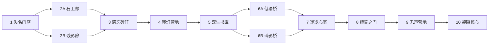

# PvE 第一期完整策划：虚空迷宫

更新：2026-10-13 · 内容版本：`void-labyrinth-v1-draft-1`

**状态：完整策划草案，尚未实现为可玩的冒险。** 现有 `pve_4v6` 战斗基础和 instant VFX 可复用；本文中的地图、敌人脚本、预告、营地、存档与奖励仍需开发。数值属于首轮原型起点，未经过模拟或真人通关标定。

配套：[30份遭遇战配置草案](data/void-labyrinth-v1.encounters.json)。该文件标记为 `design_draft_not_runtime`，现有接口不会加载它。本文是行为约定，JSON记录三档敌人预算、身份、站位和Boss差异；上线前应生成并验证正式内容版本。

## 1. 产品目标与明确边界

玩家用自己创造的英雄组成小队，进入一个会吞噬姓名、拼接记忆的迷宫，通过辨认敌人职责、拆除仪式节点和管理资源完成一次冒险。图片创造的角色是冒险主角；迷宫负责提供可理解、可练习、可复玩的战术考题。

一期交付三个独立关卡版本，共用世界观、地图骨架与Boss身份，分别面向团队总BP **1000、5000、10000**。团队总分定义为本次上阵角色原始BP之和，通常四人；不是最高单卡BP，也不是当前HP、稀有度加成后的预算或全收藏BP。允许1–4人进入，但一期平衡与荣誉目标按四人队伍验收，不保证单人同分具有同等难度。

- 敌人使用固定关卡预算，不随入场队伍重新缩放。更强的英雄确实更容易通关，保留角色背景与实力差异。
- 三档从开始即开放，可跨档挑战；±10%仅用于“同档挑战记录”资格，不阻止进入，不复制竞技匹配门槛。
- 一期试运营免费进入、免费重试；不使用竞技押注，不扣收藏角色生命，不发生永久死亡。原概念中的PvE Dust门票延后评估。
- 保留既有竞技相近BP匹配和Train规则。PvE有独立存档、目标判定和奖励资格。
- 首期使用节点地图与现有卡牌战场。护盾、净化、召唤、冷却、护卫、遗物战斗加成不是关卡通关前提；完整3D天降继续暂停。

| 版本 | 推荐团队BP / 同档记录区间 | 核心考题 | 常规敌人数 / Boss单位数 | 时长目标（待实测） |
| --- | --- | --- | --- | --- |
| 残灯入口 | 1000 / 900–1100 | 识别治疗、持续伤害和仪式锚点；学会集中攻击 | 2–3 / 2 | 20–30分钟 |
| 镜渊回廊 | 5000 / 4500–5500 | 前后排突破、跨战资源、双锚点取舍 | 4–5 / 4 | 25–40分钟 |
| 无光心室 | 10000 / 9000–11000 | 六敌协同、治疗链、预告打断与多目标压力 | 5–6 / 6 | 30–45分钟 |

高档在敌人数、协同和仪式复杂度上升级；并非把低档数值机械乘五或乘十。四人没有六次行动，不能仅靠总BP判断难度，必须实际验证敌方行动数量、治疗效率和控制收益。

## 2. 世界观、叙事与探索节奏

迷宫是古代记录官封存“无法被命名的事物”所建的石质档案库。裂隙打开后，名字从碑文和面孔上被抹去；守卫重复守护已经消失的对象。核心的无名织界者靠虚空锚维持仪式。

玩家目标：跟随仍有姓名的残灯，找到核心并切断迷宫的编织。剧情不决定玩家自创角色的来历，不改写上传肖像。

- 开场两句：“墙上的名字正在消失。”“带上你的同伴，沿残灯抵达核心。”可跳过，再次挑战不强制重播。
- 每个节点一句环境线索，战斗前最多两句情报。读碑可以获得敌人机制说明，不占行动、不收费。
- 三档同一地点呈现不同侵蚀程度：入口尚能辨字，回廊出现重叠记忆，心室只剩断裂称谓。复玩获得不同叙述，不强制收集剧情才开放高档。
- 首次遇见祭司、持续伤害、精英预告和锚点时各有一条解释；已经见过的解释可折叠。
- 两次岔路决定遭遇组合；首期没有随机陷阱、不可见负面事件、限时逃离或走错永久损失。

## 3. 十节点地图与逐关挑战

每条实际路线固定访问10个节点：6场普通战斗、2处营地、1场精英、1场Boss。N2与N6各二选一，选择后汇合；没有额外隐藏必经战。每档10份遭遇配置含两个分支替代，共30份；一次通关只打8场。

地图在选择前显示分支的敌人职责、敌人数与威胁词，例如“石卫：较慢／防线坚固”“残影：较快／集中攻击”；不把未知机制当惊吓惩罚。未来节点只遮盖具体剧情，不遮盖营地位置和Boss位置。队伍准备页允许调整六格内的四人站位；战斗中不能移动卡牌躲预告。

下表每格对应配套JSON中的固定站位与逐敌BP；“巡卒×2”等重复单位各有独立行动和状态。

| 节点 | 1000：残灯入口 | 5000：镜渊回廊 | 10000：无光心室 | 设计作用 |
| --- | --- | --- | --- | --- |
| N1 失名门庭 | 巡卒、斥候 | 巡卒×2、斥候、弓手 | 巡卒×2、斥候、弓手×2 | 学习前后排与目标合法性；第一场不放治疗 |
| N2A 石卫廊 | 巡卒×2、弓手 | 巡卒×2、弓手×2 | 巡卒×3、弓手×2、低语者 | 单列突破，远程切后排；慢战适合单体队 |
| N2B 残影廊 | 斥候×3 | 斥候×3、寄生体、弓手 | 斥候×3、寄生体×2、弓手 | 快速敌人压血线，群伤更有价值 |
| N3 遗忘碑阵 | 巡卒、寄生体、低语者 | 巡卒、寄生体×2、低语者 | 巡卒×2、寄生体×2、低语者、弓手 | 第一次明确解释DOT与诅咒；营地之前考资源 |
| N4 残灯营地 | 修整或祷灯 | 同左 | 同左 | 恢复与短期进攻增益二选一；保存检查点 |
| N5 双生书库 | 巡卒、祭司、弓手 | 巡卒×2、斥候、祭司、弓手 | 巡卒×2、斥候、祭司×2、弓手 | 治疗来源有独立图标；高档双治疗，鼓励拆链 |
| N6A 低语桥 | 巡卒、低语者、寄生体 | 巡卒、低语者×2、寄生体 | 巡卒×2、低语者×2、寄生体、弓手 | 减益持续但可到期，控制和集火均可解 |
| N6B 碎影桥 | 斥候×3 | 斥候×3、弓手、寄生体 | 斥候×3、弓手×2、寄生体 | 偏即时伤害；给缺持续作战能力的队伍另一条路 |
| N7 迷途心室 | 巡卒、寄生体、弓手 | 巡卒、寄生体、祭司、低语者、弓手 | 巡卒×2、寄生体、祭司、低语者、弓手 | 已学职责综合题；六个活跃敌人验证完整行动序列 |
| N8 缚誓之门 | 监守、祭司 | 监守、巡卒、祭司、低语者 | 监守、巡卒×2、祭司、低语者、弓手 | 公开蓄力、控制取消，为Boss预热 |
| N9 无声营地 | 修整或祷灯 | 同左 | 同左 | Boss前最后调整与检查点；公开Boss循环 |
| N10 裂隙核心 | Boss、单锚 | Boss、巡卒、双锚 | Boss、巡卒×2、祭司、双锚 | 相同Boss，分别解单锚、双锚、六单位协同 |

### 初始敌人总BP预算

这是整场敌人BP之和，不是每只敌人的BP。N2与N6两个分支总预算相同，优势来自阵容相性。敌人均为common，避免隐藏稀有度预算；预算增加只是起点，不能替代实战难度标定。

| 战斗节点 | 1000档 | 5000档 | 10000档 |
| --- | ---: | ---: | ---: |
| N1 | 720 | 4100 | 9200 |
| N2A / N2B | 780 | 4500 | 10000 |
| N3 | 820 | 4700 | 10400 |
| N5 | 840 | 4800 | 10800 |
| N6A / N6B | 880 | 5000 | 11200 |
| N7 | 920 | 5200 | 11600 |
| N8 精英 | 1000 | 5600 | 12200 |
| N10 Boss | 1050 | 6000 | 13000 |

不得临场根据玩家赢得快就提高预算，也不得在玩家失败后偷偷降低。调优通过新内容版本调整，活跃存档保留旧版本。

## 4. 敌人职责、技能与数值生成

敌人是固定内容模板，不调用图片生成/LLM随机造敌。每个角色有公开职责、技能、MP消耗和下一行动。相同内容版本、关卡、种子必须得到相同属性与行为。

配套JSON提供每种敌人的属性预算份额；份额是消耗BP的比例，不是面板数值比例。按仓库成本 `HP=1, MP=1, ATK=4, DEF=8, SPEED=10` 分配，向下取整，DEF按模板封顶，所有剩余预算返还HP，其他基础属性CC/CA/PI/EV/AC为0。例如100BP的18%攻击预算得到4ATK，余数返回HP。实际属性成本必须恰好等于分配的NPC BP。

先按遭遇中的权重分配逐敌BP，使用最大余数法、同余时按站位升序；JSON已给出分配结果。NPC DEF上限16–28，控制高BP防御挤满80%减伤的风险；不免费给属性、不用独立隐藏倍率。玩家原有稀有度预算仍生效，同原始BP的不同卡不强行同面板。

技能伤害倍率只是策划记法：现有伤害为 `ATK + DMG`，实现1.2倍时应写 `DMG=round(0.2×ATK)`，再经过现有命中、减伤、暴击结算，不能直接把1.2填进DMG。所有耗蓝为施法者最大MP的比例，向上取整且最低1，实际施放才支付一次；MP不足改普通攻击，预告明确更新。默认攻击不耗MP。

| 敌人 | 可识别轮廓 / 职责 | 正常行动循环与技能 | 玩家应对 |
| --- | --- | --- | --- |
| 裂隙巡卒 | 重石甲、断盾 / 守住一列 | 普攻→石纹加固→普攻；加固自己DEF +3，持续2回合，消耗12%MP | 集火同列突破，远程绕后；这是属性增益，不是假护盾 |
| 虚空寄生体 | 长缠丝、空腹 / 持续伤害 | 普攻→寄生咬印→普攻；普通伤害并附2回合中毒，每跳12%自身ATK，消耗12%MP | 提前消灭、治疗或等状态到期；不要求尚未实现的净化 |
| 残影弓手 | 破环弓、长轮廓 / 后排点杀 | 普攻→普攻→裂弦；裂弦1.2倍单体，优先合法目标中当前ATK最高者，消耗12%MP | 远程切入；前排突破后近战也能处理 |
| 铭刻祭司 | 书页与断面光 / 治疗 | 普攻→普攻→续写；治疗生命比例最低的存活友军，消耗15%MP | 打断或优先杀死，拒绝无限拖战 |
| 低语者 | 缺面兜帽、漂浮字屑 / 诅咒 | 普攻→失名→普攻；普通伤害并降低目标ATK，降低量为自身ATK的10%，持续2回合，消耗12%MP | 控制或集火；面板显示实际降低数值 |
| 失序斥候 | 裂开的细刃、低姿态 / 快速集火 | 普攻→折步刺；1.2倍单体，选合法目标中生命比例最低者，消耗12%MP | 群伤降低敌方行动数量，照顾低血队员 |
| 缚誓监守 | 巨门形石身、缚金索 / 精英预告 | 普攻→蓄力→断誓→恢复；1000/5000/10000分别预告1/2/3目标，伤害1.25/1.20/1.15倍，消耗10%MP | 看预告、补血或眩晕取消；恢复行动不回血 |
| 无名织界者 | 无面旧金冠、黑色骨架 / 核心仪式 | 详见下节，四行动公开循环 | 拆锚、断治疗、控制或高伤强杀均有价值 |
| 虚空锚 | 黑碑与空白名字 / 机制物 | 无主动行动，不攻击，不因“等待”回血；仍是可选、可被伤害的敌方目标 | 破坏后立即更新本轮仪式说明 |

祭司治疗量为 `round(0.25×自身最大HP + 0.015×本场敌人总BP)`，全程固定整数，不能超目标最大HP，不复活。不受同伴数量放大；生命比例并列时选站位最小者。MP耗尽后不再治疗，防止无法收尾。

普通攻击与未特指技能默认选择合法目标中生命比例最低者，比例相同按站位升序；完整目标与动作意图提前公开。循环索引只在成功执行该阶段后推进；普通单位眩晕跳过行动时不偷跑循环。控制、DOT与属性增减使用现有字段与时点，不写文案外的额外效果。

**前后排规则是开发依赖。** 六格为前排0/1/2、后排3/4/5，对应三列。近战可选择任意敌方列，但同列前排活着时不能打后排；前排倒地或为空可打其后排。远程可选任意存活敌人，群体技能仍按自身合法范围选取。不能按攻击者自己的列限制选择，造成单人无法清场。准备后站位固定，系统不会要求玩家在战斗中换列躲技能。

## 5. Boss：一个身份、三道不同考题

Boss统一循环按**自己实际执行的行动**计算，不按动画秒数：①普通攻击 → ②织界蓄力并标记 → ③裂界释放 → ④仪式恢复，然后重复。蓄力与恢复都占一次行动，不攻击、不回资源；不是10%回复的Wait。开战详情页显示循环，第一次进入核心可逐步展开教学。

蓄力优先标记当前ATK最高的存活玩家，并列按站位；按档位取前1/2/4人。标记以角色身份锁定，不因为血量变化或后续目标死亡而补选别的人。预告至少跨越Boss相邻两个行动，客户端显示预计伤害、目标数、诅咒与打断条件。

| 项目 | 1000：残灯入口 | 5000：镜渊回廊 | 10000：无光心室 |
| --- | --- | --- | --- |
| 敌方站位 | 前中Boss，后左单锚 | 前中Boss、前右巡卒；后左/右双锚 | 前左/右巡卒、前中Boss；后左/右双锚、后中祭司 |
| 裂界基础范围 | 1名标记目标 | 2名标记目标 | 4名标记目标 |
| 裂界伤害 | 1.4倍ATK | 1.35倍ATK | 1.2倍ATK |
| 左锚作用 | 将单体伤害从1.0提高至1.4倍；拆除回到1.0倍 | 将范围从1提高至2目标；拆除降至1 | 将范围从2提高至4目标；拆除降至2 |
| 右锚作用 | 无右锚 | 裂界命中后附1回合ATK诅咒，降低Boss ATK的10%；拆除取消附加诅咒 | 同左；四人波次中诅咒形成下一回合压力 |
| 战术选择 | 先拆锚降低风险，或控制/集中输出Boss | 左锚减覆盖、右锚去减益；右巡卒保护右锚，左锚可直接近战 | 两个巡卒保护双锚，祭司维持血线；突破、远程拆点、控制各有路径 |

精确规则：

1. 锚点不是无敌阶段。Boss始终能受到合法攻击，不要求特定技能、元素、治疗角色或远程才能通关。
2. 蓄力后拆锚当场降低待释放仪式：范围缩小时保留原标记顺序前N人，其余人撤销标记；不更换目标。拆右锚取消附加诅咒，已经存在的旧诅咒正常到期。
3. 待释放期间Boss的行动被眩晕跳过，待释放仪式取消，写取消事件并撤回标记；下一次未被跳过的行动进入恢复。其他阶段眩晕按正常规则跳过，不免费增加行动。没有隐藏控制免疫。
4. 释放时MP不足，取消仪式并进入恢复，不扣负MP、不改为攻击另一个目标。耗蓝为Boss最大MP的10%，对所有命中目标总共支付一次。
5. 标记目标倒地时不补目标；剩余目标仍分别进行正常命中、闪避与减伤结算。群体法术不是强制必中，伤害估值会随当前属性改变。
6. Boss死亡时，其余虚空锚立即崩解，写独立死亡/机制事件；活着的巡卒与祭司仍须击败。强杀Boss是另一条有效路线，不强迫重复清理无威胁道具。
7. 没有50%血量隐藏变身、即时插队或临死免费施法。一期复杂度来自可见阵容；若后续增加阶段，另开规则版本。

## 6. 冒险资源、营地、失败与续玩

### 进入与跨战资源

进入时固定上阵角色快照：身份、原始BP、稀有度、基础状态、技能、肖像、站位与规则版本。首次满HP/MP；途中不可换卡、换技能或通过收藏修改恢复战斗资源。重新开始新冒险才能换阵容，原冒险奖励资格不重置。

每战结束保留存活英雄的当前HP/MP；倒地状态仅属于本次冒险。状态及临时属性增减在遭遇结束清除，HP/MP按快照的最大值截断；DOT不在读地图时继续跳。每个新遭遇的开场被动仍各触发一次，不能重复加载刷被动。

为了保留续航取舍，同时限制留下最后一个弱敌反复回满：**一期建议仅PvE每角色每场最多等待2次**，每次仍占行动、恢复最大HP/MP各10%；眩晕中不能使用。界面显示剩余次数。这是待实现的PvE规则，竞技/Train/普通本地对战维持既有等待行为；PvE本地预览必须使用同一限制。治疗技能可以正常使用，持续伤害等所有现有技能兑现原效果。

### 两处营地，同一套选项

- **修整**：所有存活队员恢复最大HP/MP各35%；若有倒地者，可选择一名以30%HP、20%MP复起，该队员不再叠加本次35%恢复。其他倒地者仍倒地。无倒地时不能虚构复活收益。
- **祷灯**：下场战斗前两个完整回合，每名当时存活队员获得ATK增益 `floor(0.02×该角色稀有度属性预算 / 4)`；第三回合开始移除。死亡者不复起，不能累计到后续多场。

35%是一期建议，替代旧20%恢复草案，理由是一次通关有8场战斗且限制了等待。必须通过无治疗阵容与治疗阵容对照测试校准；不是已经上线的增益。营地选项确认一次后保存，不通过刷新再次恢复或叠加祷灯。所有人倒地会当场失败，不能靠进入营地绕过失败。

### 胜负、检查点与重试

- 本场清除条件是敌方所有单位倒地，包含Boss死亡导致的锚点崩解。己方全灭即失败；双方同一结算步骤全灭按失败处理。
- 30回合仍有敌人存活，判“本场未清除”，不以双方剩余HP总量判玩家获胜。结算完第30回合再检查，最后一击清场仍算成功。当前引擎的剩余HP比较不适合作为冒险通关规则，需要PvE分支实现。
- 入口和两处营地选择完成后设检查点。失败可免费重试，恢复最近检查点的阵容、资源、祷灯状态与节点位置；检查点以后需要重打的战斗重新执行，不能保留击杀进度同时拿回资源。
- 营地选择、分支选择与遭遇种子在本次冒险内固定；重试不重抽敌人或营地，不可反复叠加收益。历史最远进度可保留，当前通关状态回到检查点，两者区分存储。
- 地图与战斗中都可退出、恢复；中途退出不判负。完整保存当前回合、行动索引、双方资源与状态、NPC循环、Boss标记、随机数状态、事件游标等。退出回来继续原行动，不重新触发被动，不重新掷刚才的结果。
- 一期每账号每主题允许一个活跃冒险；开启另一档先明确结束现存冒险，已获得首通奖励与通关记录永久保留。不存在无操作超时导致单人冒险扣资源。

## 7. 奖励、复玩与商业化接口

目标是让三档成为英雄的挑战目的地，同时不让资源产出失控。首期以免费验证玩法和有限首通为主，暂不将耗时挑战作为付费门槛。

| 档位 | 一次性首通Dust草案 | 主题收藏展示 | 同档荣誉记录 |
| --- | ---: | --- | --- |
| 1000 | 100 | 残灯通关印记 | BP区间合格时记录回合数、重试数、队伍 |
| 5000 | 250 | 裂镜通关印记 | 同左 |
| 10000 | 500 | 无光通关印记；一期主题卡背 | 同左 |

Dust值必须对照实际造卡/修复成本校准后才能上线；上述不是已经运行的收益。三个档位分别首通，最多共850草案Dust。高BP队伍挑战低档仍可获得有限首通与故事进度，但不进入该档同分记录。

- 重复挑战不重复产Dust，只更新个人最佳记录、试阵结果和已解锁故事。当前一期不发“尚未接入战斗”的强力遗物，也不按胜场无限掉可交易材料。
- 不按现实时间排行，暂停不吃亏。记录总战斗回合数和失败重试次数，优先少重试、再比较总回合数；当前尝试与重试历史分开，失败重打回合计入本次冒险总数。
- 一期只做个人记录，不承诺公开排行榜。通关页提供队伍分享图与机制复盘，是否对外分享由玩家主动触发。
- 首通唯一键：账号 + 主题 + 档位；内容补丁不重置资格。内容版本另记在战报，防止“换版本再领奖”。奖励入账和首通账本在同一事务，重复请求只返回原领取记录。
- 后续商业化优先是卡背、营地外观、肖像边框、迷宫故事扩展；战斗关键信息与重试保持免费。付费装饰不遮目标、血条或预告。不在本期新增充值流程。

## 8. 美术总监简报

### 风格与画面主次

沿用项目已确认的暗色战术与仪式材质：煤黑石墙、磨损金属、旧金铭刻、少量羊皮纸与烟。虚空表现为被删掉的面孔、文字负形、断裂几何和暗紫灰微光，不以整屏高饱和紫色或霓虹HUD表现。

基础色：背景煤黑 `#0F1015`、玄武岩 `#242632`、旧金 `#B39A60`、虚空灰紫 `#887FA1`、可读刻字 `#DED8C9`、危险余烬 `#B67854`。色值只是材质方向，界面文本仍需实际对比度检测。危险必须同时有标记形状与文字，不能仅靠紫/红区分。

视觉层级：玩家卡牌与行动按钮 → 当前目标/预告 → HP/MP/状态 → 敌人职责 → 环境。战场中央保留低细节的石面，背后高反差裂隙避开卡牌、数值与手动按钮。玩家肖像保持原貌，主题边框只能轻度统一材质。

### 同一迷宫的三档环境差异

| 项目 | 残灯入口 | 镜渊回廊 | 无光心室 |
| --- | --- | --- | --- |
| 建筑 | 完整石拱、尚能读的名字 | 石墙复制、镜面错位、重复门洞 | 悬断石肋、空白铭文、向核心收束 |
| 光源 | 少量温暖残灯 | 灯火被镜面分裂，冷光占比增加 | 核心极弱冷光，预告时出现旧金轮廓 |
| 动态点缀 | 稀疏尘粒 | 缓慢漂移字屑 | 断裂文字环；频率低且可关闭 |
| 腐化层 | 轻度裂纹 | 镜面重影与姓名缺失 | 空白面孔与空间断层 |

三档复用同一批底图，制作独立侵蚀覆盖层与灯光版本；禁止只提高Bloom当高难辨识。屏幕摇晃和装饰漂浮不是难度信息。

### 环境资产与角色资产

六张环境底图对应门庭、回廊、碑阵、书库、营地、核心。断桥在回廊底图上叠桥面/断裂层；N7在碑阵底图上叠心室门；N8在门庭底图上叠监守巨门。N4/N9共用营地，后者熄灭更多灯。岔路通过地图图标与腐化层区别，不另做六套新背景。

| 资产 | 数量与制作规格 | 交付要求 / 优先级 |
| --- | --- | --- |
| 环境底图 | 6张，工作源2560×1440；含安全构图区 | 分层源文件；桌面/移动裁切；P0 |
| 侵蚀与场景差异层 | 3档共享裂纹/字屑/桥/门模块 | 可独立减弱，避免遮挡角色；P1 |
| 普通敌人肖像 | 6张，工作源768×1152 | 巡卒/寄生体/弓手/祭司/低语者/斥候，缩略轮廓仍可辨；P0 |
| 精英、Boss、锚点肖像 | 3张，同上 | Boss无面旧金冠，精英门形轮廓，锚点黑碑；P0 |
| 地图与职责图标 | 10个节点图标 + 6个职责图标 | 普通/营地/精英/Boss形状有区别，含文字标签；P0 |
| 仪式预告组件 | 标记环、连线、取消碎片3件 | 1/2/4目标、断锚后即时撤回，减少动态时静态；P0 |
| 奖励展示 | 3个通关印记 + 1张主题卡背 | 仅装饰，不写未实现的战斗加成；P1 |
| 剧情插图 | 开场/结尾可各1张 | 首期可复用门庭/核心背景，独立插图延后；P2 |

敌人不能只用同一剪影换色。巡卒宽而重、斥候矮而锐、弓手细长、祭司书页展开、寄生体弯曲、低语者上窄下散。Boss的“身份缺失”靠面部负形与破冠表达，不能是随机炫光覆盖肖像。

导出背景优先WebP/AVIF，单张目标≤400KB（细节不足时允许调整并测量）；肖像分缩略/战斗两级，按设备加载。一次仅载当前与下一节点，不能首屏同时下载三档全部资产。保留sRGB、命名版本与裁切元数据；源稿不计入网络包。

### instant VFX：首期可执行方向

继续复用现有 `battleInstantParticles` 与一次施法多目标分组，不重新接入Three天降系统。技能身份通过颜色、轨迹和落在卡牌上的结果区分。

| 技能 | 复用效果 | 要打磨的反馈 |
| --- | --- | --- |
| 普通斩击 / 折步刺 | strike / pierce | 刀线短、撞击点清楚，不能每目标重复播放施法者动作 |
| 寄生咬印 | poison | 一次命中后独立毒标，下回合跳伤和本次伤害分开 |
| 失名 / 断誓 | dark + 现有命中 | 减攻数字与状态说明，预告取消有明确“已打断”文字 |
| 续写治疗 | light / heal反馈 | 绿色结果数值与书页亮点；保留命中目标数与一次MP扣除 |
| 裂界仪式 | dark instant，同施法分组 | 蓄力先标目标；释放同一节拍多目标命中，各自数值/闪避；等待所有结果后推进 |
| 石纹加固 | 现有pray光环 | 防御图标+实际增加值，不画会误导为独立盾值的护盾条 |
| 锚点破坏 | dark碎裂 + 静态裂纹 | 断锚时更新目标/减益预告；不靠大爆炸掩盖机制 |

场内最多一个共享特效层，六目标不是六个渲染器。减少动态效果模式去掉摇晃、拖尾和装饰粒子，保留静态标记、结果数字、目标数、施法与取消事件。目标1/3/6与友方治疗都在已有VFX实验页检查；战斗实际Boss通常1/2/4，但同一表现系统须覆盖6。

音频采用三层：进入/探索环境、普通战斗低频节奏、核心仪式变奏；共用音乐素材变化，不为三档录九首。另制6类音效：选择、标记、释放、打断、断锚、通关。释放音只按一次施法触发，不能六目标叠六声巨响；遵守静音与音量设置。

## 9. 页面、信息与交互流程

1. **主题入口**：展示三档推荐总BP、敌人数、核心考题、已通关状态、首通奖励。锁定内容未上线时准确标“策划中”，不能提供失效的开始按钮。
2. **队伍准备**：选择1–4张已有卡，显示总BP、同档记录资格、前后排、技能范围；提醒低人数但允许进入。自动建议站位可覆盖，不自动更换卡牌。
3. **迷宫地图**：10节点、两处营地、当前资源、检查点、下场情报；有“继续”“结束本次冒险”。结束有明确说明，因为会失去当前未完成进度。
4. **遭遇详情**：敌人站位、职责、总BP、预告规则。可检查全部技能与MP，不收情报费。
5. **战斗**：既有手动操作；敌人下一行动可查看，Boss标记常驻。资源不足、范围非法、等待次数用尽都在操作前解释。自动控制若开放，使用同一合法动作和规则。
6. **战后**：HP/MP变化、关键机制事件、下一节点。死亡是“本次冒险倒地”，不写“收藏卡永久死亡”。
7. **营地**：两项明确列出每人预计回复量或实际ATK加值；复起目标显式选择，确认后保存。
8. **失败/续玩**：说明全灭或回合上限、检查点恢复内容、免费重试；退出不等于失败。
9. **通关**：奖励入账状态、队伍BP、档位、回合/重试、控制与锚点事件摘要、个人纪录资格；重复通关显示“首通已领取”。

移动端优先让4友军/6敌人与当前技能目标可操作；敌人详情抽屉按需展开，不能把6张卡压成无法辨认的小点。装饰视差与地图粒子可关闭，战斗数据不会依赖动画结束才保存。

## 10. 后端、内容版本与防重复结算约定

现有战斗/session入口可承载遭遇，但当前会话管理主要在内存，不能当作完整冒险持久化。以下为新增设计，不是现有API声明：

- `POST /api/pve/runs`：传主题、档位、己方收藏ID与站位；服务器核验归属、快照、总BP和活跃冒险限制，返回run与内容版本。客户端不得提交可信的敌人属性、奖励或冒险恢复资源。
- `GET /api/pve/runs/{id}`：返回当前地图、资源、检查点、奖励资格与可恢复battleSession。
- `POST /api/pve/runs/{id}/enter`：传节点、分支、预期run revision与请求幂等键；一次创建遭遇。相同请求返回已有会话。
- `POST /api/pve/runs/{id}/camp`：传选项、可选复起角色、revision与幂等键；原子执行并存检查点。
- `POST /api/pve/runs/{id}/retry`：原子恢复检查点，增加重试数，保持分支与种子固定。
- `POST /api/pve/runs/{id}/abandon`：结束当前冒险；不撤销已经入账奖励。
- 战斗操作复用现有session动作接口；PvE上下文由服务端绑定，不允许任意 `pve_4v6` 试验战领取冒险奖励。清除后服务端推进节点和首通账本，不接受客户端“我赢了”的声明。

建议持久化四类记录：`pve_runs`、`pve_encounters`、`battle_session_state`、`pve_reward_ledger`。至少存：账号、队伍快照、档位、当前/历史节点、分支、种子、随机生成器状态、内容及规则版本、HP/MP、临时状态、等待次数、NPC循环、待释放标记、回合/行动索引、事件游标、检查点、revision、奖励唯一键。

动作、战斗状态、事件与run推进必须保持原子一致；服务重启不会回退已经认可的行动。每个session使用独立可保存的随机数生成器，不用进程级 `random.seed` 影响同时在线的竞技。双标签页用revision检测过期写入，重试幂等请求不能重复扣MP、跨两节点或多发首通。

旧竞技、Train、普通本地预览继续原规则；PvE专属的等待上限、前后排版本、清场与超时等通过明确mode/rulesVersion选择。前后排若随后扩展竞技，另记规则变更和兼容回放，不在发布PvE时静默改变旧对战。

## 11. 平衡验证与上线验收

### 平衡目标（需要模拟与真人试玩，不是现有数据）

每档测试四人平衡队、无治疗队、全近战队、远程集火队、群伤队、控制队；覆盖同分的common/rare/mythic预算差异、相同总分下偏一强三弱的队伍。允许偏科队有优势或劣势，但不能靠一个未提示机制硬性要求玩家生成特定卡。

首轮至少每档6类阵容、每类100个独立种子：共1800条完整冒险模拟，再补真人手动测试。模拟必须真实携带HP/MP、营地选择与等待限制，不能每节点免费回满。将正常策略、忽略关键目标与控制策略对照，验证玩家学会规则后通关率改善。

| 指标 | 残灯入口 | 镜渊回廊 | 无光心室 |
| --- | --- | --- | --- |
| 熟悉基础操作的四人队首次完整通关目标 | 60–75% | 40–60% | 25–45% |
| 学会机制后的重复通关目标 | ≥85% | ≥70% | ≥60% |
| 战术区别应被观察到 | 杀祭司/拆单锚提高成功率 | 双锚选择改变损血与耗蓝 | 六单位优先级与打断时机影响胜率 |

这些比例是体验目标，不是给每场硬编码胜率。先调整NPC预算、行动频率和支援效率，再考虑机制增加；不能修改玩家技能承诺或动态操纵命中让Boss赢。

### 关键验收场景

| 场景 | 必须得到的结果 |
| --- | --- |
| 1000队伍改成1100或2000进入同档 | 敌人属性与BP不变；2000仍可首通但无同档记录资格 |
| 同总BP的不同稀有度/队伍分配 | 保留真实属性与技能；不强制同胜率；有多类可通关阵容 |
| 六活跃敌人的N7 | 六敌按速度/既有顺序获得行动；无名单截断、重复行动 |
| 全近战面对双锚 | 击败相应巡卒后能攻击锚点；空列后排从开始即合法，无死锁 |
| 蓄力后击破左锚 | 本次待释放目标立即减少，撤回对应标记；一次MP成本 |
| 蓄力后眩晕或MP不足 | 取消事件、标记撤回、无伤害；眩晕实际跳过次数正确 |
| Boss强杀 | 存活锚点崩解；仍存活的巡卒/祭司继续，全部击败才清场 |
| 群体命中/闪避混合 | 每目标分别结算、一次施法/一次MP，全部反馈结束再推进 |
| 第30回合留一名敌人但己方HP更多 | 不通关，不领取清场奖励 |
| 第30回合最后一击击败全部敌人 | 通关；同时全灭则失败 |
| 等待2次后再次尝试，或眩晕中等待 | 拒绝且不恢复、不扣其他资源、不推进错误行动；其他模式不受PvE限制影响 |
| 营地刷新、重复提交、复起选择 | 只结算一次；最多复起一人；祷灯只作用下场前两完整回合 |
| 失败重试 | 回到检查点，战斗重新打，不能资源回满而保留检查点后击杀 |
| 蓄力/中毒/半回合时退出及服务重启 | 原状态继续，目标、RNG、MP与事件不重抽、不重放扣费 |
| 首通后重试请求或内容补丁 | 同一账号主题档位只入账一次；没有版本刷奖励 |
| 手动、自动、REST、PvE本地预览 | 同动作/种子/规则版本得到一致效果与资源成本；控制器策略可以不同 |
| 六目标与减少动态、移动窄屏 | 数值与标记可读，单共享特效层，关闭动画仍可操作和复盘 |

埋点建议：入场档位/总BP/阵容职责、节点与分支、每场回合/耗蓝/等待/损血、关键目标击杀顺序、蓄力取消原因、失败位置、营地选择、续玩成功率、首通账本状态。不要为了分析保存上传原图或另行上传肖像；引用已有角色ID和合法必要的技能版本即可。

## 12. 实施拆分与完成定义

| 阶段 | 产出 | 完成判断 |
| --- | --- | --- |
| A 规则与内容原型 | 校验三档30配置；确定性NPC生成；前后排；脚本循环/意图；Boss锚点；PvE清场/等待 | 所有验收中的战斗规则通过，六敌完整行动，同动作跨模式一致 |
| B 冒险闭环 | 主题/准备/地图/分支/营地；跨战资源；持久化与重试；首通账本 | 任一档从进入到通关及失败重试可完整运行，重启与重复请求不丢状态/不多发 |
| C 美术与表现 | 六底图/九肖像/图标；三档腐化层；instant群伤与预告；音频 | 三档辨识明确，肖像与技能结果清楚，减少动态和移动端可用 |
| D 平衡与首期发布 | 模拟、真人试玩、性能检查、奖励经济校准、规则说明 | 三档多类阵容可通关；关键失败可解释；首通资源有限且账本正确 |

可以先在现有测试模式搭建N1/N8/N10三个样板验证，再接持久化整轮冒险；不能把仅有三场样板称作一期完成。美术与玩法原型可分工并行，但正式资产须在站位安全区与预告规则确定后精修。

一期不扩展为无尽随机塔、六人玩家队伍、联网合作、地图实时移动、无限刷取材料、付费重试或新3D特效引擎。后续可加入新主题和有明确契约的护盾/净化等规则，内容版本与玩家技能效果继续可追踪。

## 13. 本次策划验证记录

本次仅新增设计与配置草案，未修改运行时代码、未生成最终美术、未进行战斗模拟或真人通关。已执行配置完整性检查：3个推荐BP档位；每档10份遭遇且路线8战；30份预算均等于逐敌BP之和；站位唯一且在0–5；敌人数不超过6；角色与控制器有明确策划；属性成本可精确还原NPC预算；文档本地链接有效。玩法与胜率仍需阶段A/D验证，不能把静态检查解释为可玩验证。
